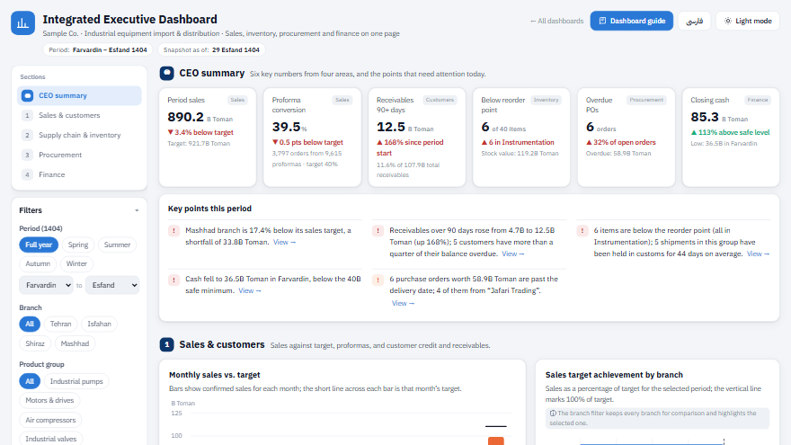
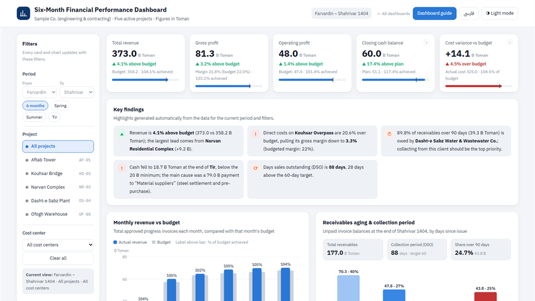
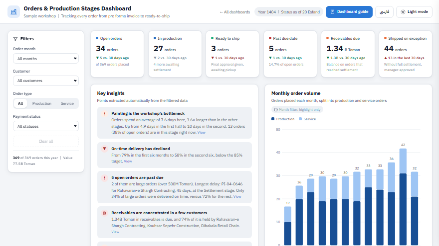
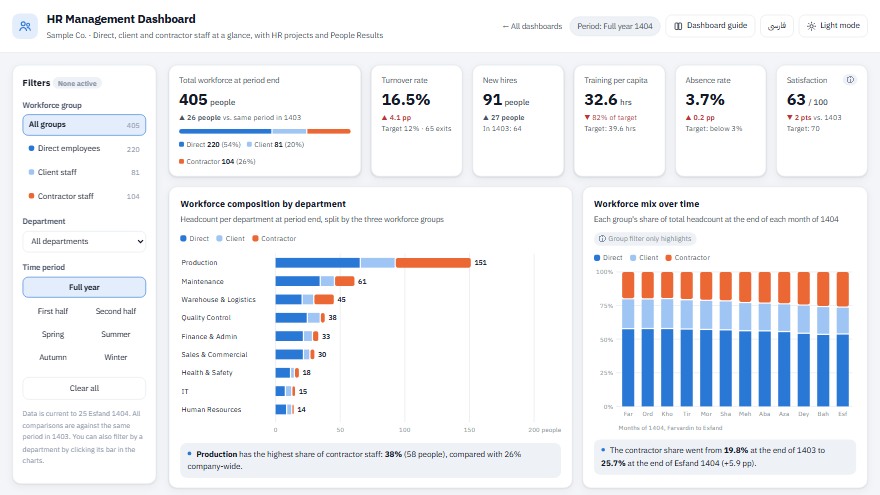

# Business Dashboard Portfolio · نمونه‌کارهای داشبورد مدیریتی

**Four interactive business dashboards (Executive, Finance, Production and HR), each fully bilingual in English and Persian, each with a step-by-step guide.**

**Live demo: [ftmmns.github.io/dashboard-portfolio](https://ftmmns.github.io/dashboard-portfolio/)** · [English](https://ftmmns.github.io/dashboard-portfolio/?lang=en) · [فارسی](https://ftmmns.github.io/dashboard-portfolio/?lang=fa)

Every dashboard turns raw operational data into answers a manager can act on: where the business stands against target, what changed, and what needs attention first. They are built with plain HTML, CSS and JavaScript, with no frameworks, no build step and no internet connection required.



## The dashboards

| | Dashboard | What it answers | English | فارسی |
|---|---|---|---|---|
| 1 | **Executive (CEO) Dashboard** | One page for the CEO: sales vs. target, proformas, inventory and goods in transit, purchasing, cash position | [Open](en/ceo/index.html) · [Guide](en/ceo/guide.html) | [داشبورد](fa/ceo/index.html) · [راهنما](fa/ceo/guide.html) |
| 2 | **Six-Month Financial Performance** | Revenue, profit and cash against budget, cash-flow waterfall, receivables aging, cost centers, project contracts | [Open](en/finance/index.html) · [Guide](en/finance/guide.html) | [داشبورد](fa/finance/index.html) · [راهنما](fa/finance/guide.html) |
| 3 | **Orders & Production Stages** | Each order from proforma and payment through ten production stages to shipping; bottlenecks and late orders | [Open](en/production/index.html) · [Guide](en/production/guide.html) | [داشبورد](fa/production/index.html) · [راهنما](fa/production/guide.html) |
| 4 | **Human Resources Dashboard** | Direct, client and contractor workforce side by side: turnover, training, absence, HR projects, excellence-model (EFQM) indicators | [Open](en/hr/index.html) · [Guide](en/hr/guide.html) | [داشبورد](fa/hr/index.html) · [راهنما](fa/hr/guide.html) |

<table>
<tr>
<td></td>
<td></td>
<td></td>
</tr>
</table>

## Highlights

- **Decision-first design:** KPI cards compare against target or budget, and auto-generated "Key findings" show what needs attention.
- **Fully interactive:** period, department and project filters update every chart; hover tooltips; sortable, searchable tables; drill-down drawers.
- **Truly bilingual:** native right-to-left Persian and left-to-right English. The English versions are mirrored by hand, not just translated.
- **Light and dark themes,** each designed separately rather than auto-inverted.
- **Responsive,** from wide monitors down to phones.
- **Documented:** each dashboard has a guide that explains every section using the dashboard's own numbers.
- **Zero dependencies:** hand-written SVG charts and self-hosted fonts (IBM Plex Sans, IBM Plex Sans Arabic, Vazirmatn).

## Run locally

Clone or download the repository and open `index.html` in any modern browser. There's nothing to install or build.

```
git clone <this-repo-url>
```

## Structure

```
index.html          Home page with English / Persian switch
en/<dashboard>/     English: index.html (dashboard), guide.html, shots/
fa/<dashboard>/     Persian: same layout
fonts/              Self-hosted web fonts
```

*All company names and figures are sample data created for demonstration.*

---

<div dir="rtl">

## نمونه‌کارهای داشبورد مدیریتی

چهار داشبورد تعاملی برای چهار نیاز رایج کسب‌وکار، هر کدام به دو زبان فارسی و انگلیسی و همراه با راهنمای کامل:

- **داشبورد یکپارچهٔ مدیریت:** فروش و هدف، پیش‌فاکتور، موجودی و کالای در راه، خرید و جریان نقد در یک صفحه برای مدیرعامل.
- **داشبورد عملکرد مالی شش‌ماهه:** درآمد، سود و نقدینگی در برابر بودجه، آبشار جریان نقد، سن مطالبات، مراکز هزینه و قرارداد پروژه‌ها.
- **داشبورد سفارش و مراحل تولید:** مسیر هر سفارش از پیش‌فاکتور و پرداخت تا ده مرحلهٔ تولید و ارسال؛ گلوگاه‌ها و سفارش‌های دیرکرد.
- **داشبورد مدیریت منابع انسانی:** نیروی مستقیم، کارفرما و پیمانکار کنار هم؛ ترک خدمت، آموزش، غیبت و شاخص‌های مدل تعالی.

ویژگی‌ها: فیلترهای تعاملی، حالت روشن و تیره، سازگار با موبایل، بدون نیاز به اینترنت یا نصب. برای اجرا کافی است فایل `index.html` را در مرورگر باز کنید.

*نام شرکت‌ها و اعداد، داده‌های نمونه برای نمایش هستند.*

</div>

---

Designed and built by **Fatemeh Mansouri** · طراحی و ساخت: **فاطمه منصوری**
